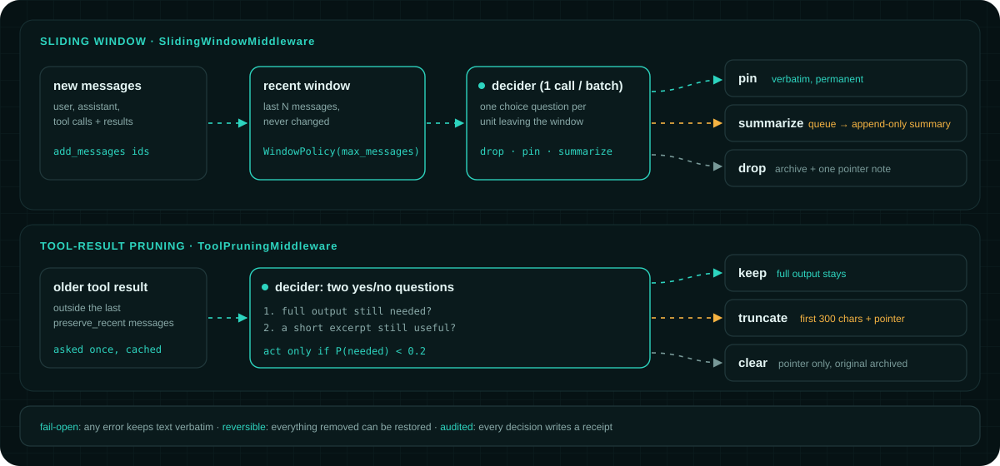

<p align="center">
  
</p>

<h3 align="center">Built by Emrecan Gök</h3>

<p align="center">
  <a href="https://github.com/Emrecangok"></a>
  <a href="https://www.linkedin.com/in/emrecan-g%C3%B6k-864b80248/"></a>
</p>

<p align="center">
  
  
  
  
  
</p>

**context-sieve decides, message by message, what stays in a LangGraph agent's context.** Built-in tools trim by rule: keep the last N messages, clear tool results older than K, summarize past a token limit. They never ask whether a message still matters. context-sieve asks a small decision model exactly that, and keeps, pins, shortens, summarizes or drops each message accordingly. Nothing is lost for good: every removed message is archived and can be restored.

The goal is an honest answer to one question: **when does relevance-based pruning beat the built-in rules, and when is it not worth it?** Negative results count.

## Features

- **Sliding window with decided eviction.** The last N messages stay verbatim. Each message leaving the window gets one question: `drop`, `pin` or `summarize`. System messages and the first user message are always kept.
- **Tool-result pruning.** Older tool outputs get two yes/no questions ("is the full output still needed?", "is a short excerpt still useful?") and are kept, truncated or cleared.
- **Summary bucket.** Messages marked `summarize` are flushed into append-only summary sections; old sections are only merged when they outgrow a budget. Bring your own summarizer.
- **Two integration modes.** `view` leaves graph state untouched and prunes only what the model sees. `state` rewrites the message history and archives originals in the LangGraph store.
- **Safe by default.** Acts only when the model is confident. Decider, archive or summarizer errors keep everything verbatim. Every decision writes a receipt.
- **Backend-agnostic decider.** One small `Decider` protocol. Ships with an OpenAI Decisions API decider (`gpt-6-luna`) and a fake for tests.

## How it works

<p align="center">
  
</p>

| Piece | What it does |
|---|---|
| `SlidingWindowMiddleware` / `SlidingWindowHook` | Keeps the last `max_messages` verbatim; asks one batched choice question per unit leaving the window |
| `ToolPruningMiddleware` / `ToolPruneHook` | Keeps, truncates (first 300 chars) or clears older tool results; each result is asked about once |
| `flush_pending`, `compact_summaries` | Turn queued messages into append-only summary sections through your `Summarizer` |
| `OpenAIDecisionsDecider` | Sends the questions to `POST /v1/decisions` and reads back probabilities |
| `InMemoryArchive`, `StoreArchive` | Keep removed originals; `restore()` rebuilds the full history in order |

A tool call and its result always stay together, and the window never reorders history.

### View or state mode

| | `view` (default) | `state` |
|---|---|---|
| Graph state history | untouched | rewritten to the pruned context |
| What the model sees | the pruned view | the state itself |
| Removed originals | still in state (message id is the archive key) | `StoreArchive` on the graph's store |
| Full history back | `hook.restore(state)` | `hook.restore(state, store)` |

## Quick start

With `create_agent`:

```python
from langchain.agents import create_agent
from langgraph.checkpoint.memory import InMemorySaver

from ctxsieve import PrunePolicy, WindowPolicy
from ctxsieve.deciders.openai_decisions import OpenAIDecisionsDecider
from ctxsieve.integrations.langchain import SlidingWindowMiddleware, ToolPruningMiddleware

decider = OpenAIDecisionsDecider()  # gpt-6-luna on the OpenAI Decisions API

agent = create_agent(
    "openai:gpt-6-luna",
    tools=[...],
    middleware=[
        ToolPruningMiddleware(decider, PrunePolicy(preserve_recent=6)),
        SlidingWindowMiddleware(decider, WindowPolicy(max_messages=20)),
    ],
    checkpointer=InMemorySaver(),
)
```

In any `StateGraph`:

```python
from ctxsieve.integrations.langgraph import CtxSieveState, SlidingWindowHook

hook = SlidingWindowHook(decider, WindowPolicy(max_messages=20))  # mode="view"

def sieve(state):                 # node before the model node
    return hook.update(state)

def call_model(state):
    return {"messages": [llm.invoke(hook.view(state))]}
```

Add the `ctxsieve_window` / `ctxsieve_prune` keys (see `CtxSieveState`) to your state schema, and use the `add_messages` reducer so messages have ids. For state mode pass `mode="state"` and give the hook the graph's store: `hook.update(state, store=runtime.store)`.

## First live run

A five-turn smoke test with real models (`python -m bench.smoke`): the agent searches the docs, and the last question asks it to recall a detail from the first message ("which checkpointer did I say I use?").

| Method | Recalled the setup? | Agent input tokens |
|---|---|---|
| full history | yes | 27,178 |
| `trim_messages` | **no**, it dropped the first message | 27,613 |
| `SummarizationMiddleware` | partly, lost the class name | not comparable* |
| `ContextEditingMiddleware` | yes | 26,148 |
| context-sieve | yes | 21,142 + 22,778 decider |

This is one short conversation, not a benchmark. context-sieve cut the agent's input by about 22%, but the decider read more tokens than it saved, so overall it cost more than doing nothing. Part of that came from a bug (since fixed) that sent evicted messages to the decider twice. In a conversation this short, pruning is not worth it yet; longer ones are the open question.

\* The smoke script counts tokens from messages left in state, and summarization deletes messages, so its count is too low.

## Benchmark agent

`bench/` holds a small agent that answers questions about the LangChain docs with a `search_docs` tool. All five methods (`full`, `trim`, `summarization`, `context_editing`, `ctxsieve`) run on the same agent, model and index.

The corpus is a frozen snapshot of 41 LangChain / LangGraph Python docs pages (MIT licensed upstream), fetched with LangChain's `WebBaseLoader` and committed in `bench/corpus/langchain_docs/`. Everyone tests against the same text.

```bash
python -m bench.build_index      # embed the snapshot once (~$0.01 with text-embedding-3-small)
python -m bench.smoke            # five turns per method with gpt-6-luna (a few cents)
python -m bench.corpus.fetch_langchain_docs --check   # see which pages changed upstream
```

## Project structure

```
src/ctxsieve/
  policy.py               tool-result pruning (keep / truncate / clear)
  window.py               sliding window with decided eviction
  summary.py              summary bucket and compaction
  region.py               what remains of messages that left the window
  archive.py              in-memory, message-id and LangGraph-store archives
  receipts.py             one record per decision
  deciders/               Decider protocol, OpenAI Decisions, fake
  integrations/
    langgraph.py          hooks for any StateGraph (view and state modes)
    langchain.py          create_agent middleware
bench/
  corpus/                 LangChain docs snapshot and its fetch script
  docs_agent.py           benchmark agent with the five methods
  build_index.py, smoke.py
tests/                    offline tests, including property tests for the invariants
```

## Setup

```bash
git clone https://github.com/Emrecangok/context-sieve.git
cd context-sieve
python -m venv .venv
.venv/Scripts/activate            # Windows; on macOS/Linux: source .venv/bin/activate

pip install -e ".[langchain,openai]"   # the library
pip install -e ".[bench,dev]"          # benchmark agent and tests
cp .env.example .env                   # then add your OPENAI_API_KEY
```

The tests run offline and need no API key:

```bash
pytest
```

## Status and limits

Early and experimental. Not on PyPI yet.

- **The decider sees too much.** Each decision request currently carries the whole current context. Sending only the opening, the candidate messages and the latest user message is the next change.
- **No summarizer ships.** Messages marked `summarize` stay verbatim until you plug one in.
- **No recall tool.** The agent sees a pointer to dropped messages but cannot fetch them back by itself yet.
- **Thresholds are untuned.** `act_below=0.2` and `drop_min_prob=0.8` are starting values, not calibrated ones.
- **No benchmark yet.** Only the smoke test above has been run.
- `langchain-community`, which holds `WebBaseLoader`, is sunset upstream. It is used only to refresh the docs snapshot.

## Credits

The keep / truncate / clear pattern for tool results follows [fast-jev-compaction](https://github.com/tamaratran/fast-jev-compaction). Decision receipts are inspired by [jev-langgraph](https://github.com/wudilyy999/jev-langgraph). [AnyJev](https://github.com/nokia-applied-research/AnyJev) informed the plan for local deciders. The benchmark corpus comes from the [LangChain docs](https://github.com/langchain-ai/docs) (MIT).

## License

MIT, see [LICENSE](LICENSE).
